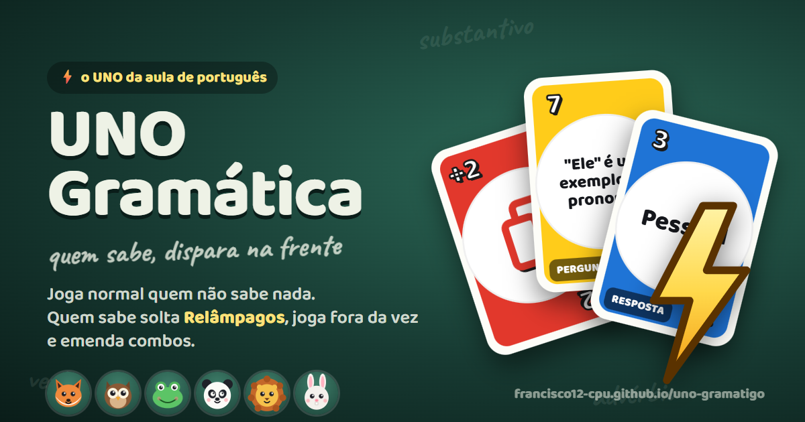

# UNO Gramática ⚡

**O UNO da aula de português** — criado por **Francisco Audir**.

Joga normal quem não sabe nada de gramática. Mas quem sabe solta **⚡ Relâmpagos**, joga fora da vez, emenda combos… e vence mais vezes.

▶ **Jogar agora:** https://francisco12-cpu.github.io/uno-gramatigo/

---

## Como funciona

As cartas de número trazem **perguntas (?)** e **respostas (!)** de gramática. Todo o resto é UNO de verdade: cor, número, Pula, Reverso, +2, Coringa, +4 e o grito de UNO!

- **Sorteio a cada partida:** cor e número das perguntas/respostas mudam toda partida. Não dá pra achar o par pela cor ou pelo número — só lendo e sabendo.
- **⚡ Relâmpago:** caiu uma pergunta e você tem a resposta (ou o contrário)? Jogue **a qualquer momento, até fora da sua vez**.
  - **📖 Ler** mostra suas perguntas e respostas por extenso.
  - **✋ Bater** congela a mesa: ninguém joga por cima enquanto você escolhe. Não escolheu a tempo (ou desistiu)? Compra 1.
- **Bônus em sequência:** Relâmpago certa = jogue cartas que combinem, uma atrás da outra, à vontade. Se terminar numa pergunta/resposta, outra pessoa (ou você!) pode soltar outra Relâmpago: **combo**.
- **Contestar:** achou que a Relâmpago está errada? Conteste. Errada: a carta volta, quem jogou compra 2 e a vez é sua. Certa: você compra 2. Depois o jogo mostra o **par certo** pra todo mundo aprender.
- **Respiro:** quando cai pergunta/resposta, ninguém joga por cima por um instante (dá tempo de ler).

### Regras configuráveis (na criação da partida ou da sala)
Juiz automático ou contestação · bônus de 1, 2 ou à vontade · tempos de contestar, respiro e bater · tempo por vez · 5/7/10 cartas no começo · **empilhar +2/+4** · **várias cartas iguais de uma vez** · **7 troca de mão / 0 gira as mãos** · dicas · cores das cartas impressas.

## Modos
- **Contra robôs:** 1 a 5 robôs com bichinhos, 3 dificuldades (os difíceis sabem mais gramática), 3 ritmos. Funciona **offline**.
- **Online:** uma pessoa cria a sala e passa o código de 5 letras (ou o link). Dá pra completar com robôs. Se alguém cair, um robô segura as cartas e a pessoa **volta pro mesmo lugar** quando reconectar.
- **Como jogar:** vídeo animado com os bichinhos jogando e explicando as regras (também em [`media/como-jogar.mp4`](media/como-jogar.mp4)).
- **Treino guiado**, **Estudar** (flashcards com repetição espaçada), **Estatísticas**, **Cartas físicas** (confere par do baralho impresso sem entregar a resposta).

## Equilíbrio (simulação)
`node tests/simular.js` joga milhares de partidas entre robôs iguais em tudo, menos no conhecimento:

| Mesa de 4 | Vitórias de quem sabe |
|---|---|
| 4 que não sabem (controle) | ~25% cada |
| 1 que sabe vs 3 que não sabem (bônus à vontade) | **~48%** (os outros ~17%) |
| 1 que não sabe vs 3 que sabem | ~10% |

Quem não sabe ainda ganha às vezes (é UNO!), mas quem sabe se destaca.

## Publicar no GitHub Pages
1. Envie todos os arquivos desta pasta (mantenha `css/`, `js/`, `icons/` e `media/`).
2. **Settings → Pages → Branch: main / (root) → Save**.
3. Abra o link no celular e toque em **Instalar no celular** (ou "Adicionar à tela inicial").
4. A cada atualização, aumente o número em `CACHE` no `sw.js` (ex.: `unogramatica-v5`): quem já instalou recebe o aviso "Versão nova — toque para atualizar".

## Arquivos
- `index.html` — telas
- `css/app.css` — visual (responsivo: celular, tablet e computador)
- `js/core.js` — motor de regras puro (roda no navegador e no Node)
- `js/app.js` — interface, robôs na mesa, online (PeerJS), estudo, estatísticas
- `js/video.js` — vídeo animado "Como jogar"
- `tests/` — testes do motor (`node --test tests/core.test.js`) e simulação de equilíbrio
- `manifest.webmanifest`, `sw.js`, `icons/` — instalação como app (PWA) e prévia do link
